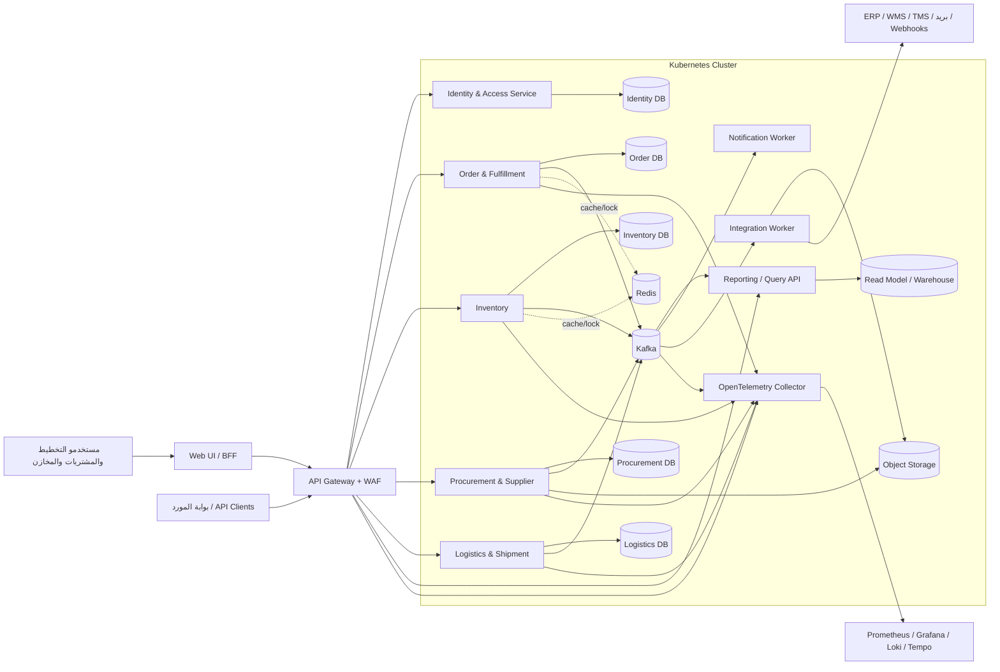
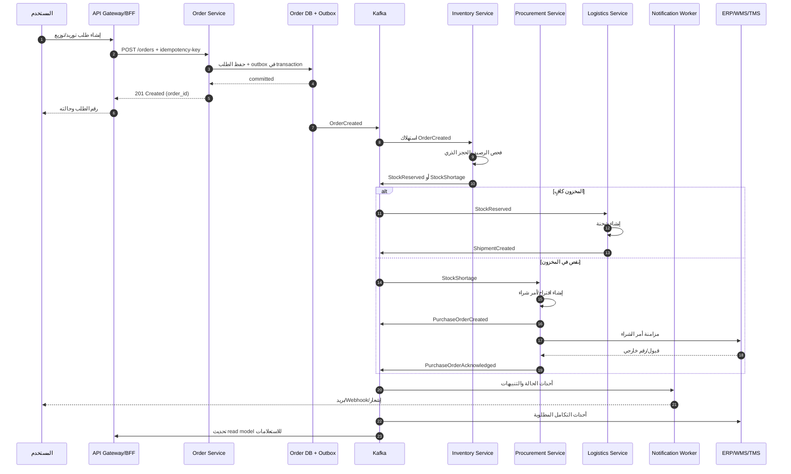

# وثيقة معمارية نظام إدارة سلسلة الإمداد الذكي

**الحالة:** مقترح معماري قابل للتنفيذ

**الهدف الزمني:** MVP خلال شهر، ونسخة كاملة خلال ثلاثة أشهر

**نطاق الوثيقة:** تصميم المنصة وخدماتها وتدفقات البيانات وتشغيلها ومراقبتها. لا تتضمن كود تطبيق.

---

## 1. الملخص التنفيذي

النظام منصة لإدارة سلسلة الإمداد من الطلب والتخطيط والشراء إلى المخزون والشحن والاستلام، مع تنبيهات استباقية وتوقعات طلب قابلة للإضافة في النسخة الكاملة. يُبنى النظام كمنصة **modular microservices**: لكل نطاق أعمال ملكية بيانات واضحة، وتُستخدم واجهات REST/JSON للطلبات الفورية وأحداث غير متزامنة لتوزيع التغييرات.

القرار المقترح هو **Kafka** كحافلة أحداث أساسية، مع PostgreSQL كقاعدة معاملات، وRedis للتخزين المؤقت والأقفال الخفيفة والطوابير القصيرة، وS3-compatible Object Storage للمستندات وملفات الاستيراد/التصدير. تُشغّل الخدمات على Kubernetes، مع OpenTelemetry وPrometheus/Grafana وLoki/Tempo للملاحظة التشغيلية.

يبدأ الـMVP بعدد محدود من الخدمات المنشورة فعليًا، ويمكن أثناء الشهر الأول تشغيل بعض الحدود في عملية نشر واحدة مع الحفاظ على فصل الوحدات والبيانات؛ ذلك يقلل مخاطرة التشغيل دون التضحية بخيار الاستخراج المستقل لاحقًا.

## 2. الأهداف والافتراضات

### 2.1 أهداف الأعمال

- رؤية موحدة للطلبات والمخزون والموردين والشحنات.
- تقليل نفاد المخزون والتأخر في التوريد عبر تنبيهات وقواعد واضحة.
- تتبع كل تغيير مهم: من غيّر ماذا ومتى ولماذا.
- دعم التكامل مع ERP/WMS/TMS والموردين عبر API وملفات وwebhooks.
- توفير أساس لإضافة توقع الطلب وتحسين المخزون دون إعادة بناء المنصة.

### 2.2 افتراضات تصميمية

- المستخدمون الداخليون هم التخطيط والمشتريات والمخازن واللوجستيات والإدارة، مع مستخدمين خارجيين محدودين للموردين.
- لكل شركة/مؤسسة `tenant_id`، حتى لو بدأ الـMVP بعميل واحد.
- حجم البداية متوسط: آلاف الطلبات اليومية وعشرات الآلاف من حركات المخزون، مع قابلية نمو أفقية.
- PostgreSQL هو مصدر الحقيقة للمعاملات؛ لا تُعتبر الرسالة المنشورة بديلاً عن الالتزام في قاعدة البيانات.
- التكاملات الخارجية غير موثوقة أو قد تعيد الإرسال؛ كل مستهلك وكل endpoint يجب أن يكون idempotent.
- البيانات الحساسة (أسعار التعاقد، بيانات الموردين، معلومات المستخدمين) تحتاج تشفيرًا أثناء النقل وفي التخزين، وضبط صلاحيات متعدد المستويات.

### 2.3 خارج النطاق الأولي

التحسين الرياضي المتقدم لمسارات المركبات، المدفوعات، إدارة أسطول المركبات، توأم رقمي للمستودع، وتطبيق جوال أصلي. تُحفظ هذه كبوابات توسع بعد تثبيت الأساس.

## 3. المتطلبات غير الوظيفية ومعايير القبول

| المجال | MVP | النسخة الكاملة |
|---|---|---|
| التوافر | 99.5% شهريًا للخدمات الأساسية | 99.9% للخدمات الأساسية |
| زمن استجابة API | p95 أقل من 500ms للقراءات الاعتيادية | p95 أقل من 300ms للقراءات الاعتيادية |
| اتساق الأحداث | تسليم مرة واحدة فعليًا عبر idempotency، مع دلالة at-least-once | نفس المبدأ مع replay وDLQ مُدارة |
| التعافي | RPO ≤ 24 ساعة، RTO ≤ 4 ساعات | RPO ≤ 1 ساعة، RTO ≤ 1 ساعة |
| التدقيق | سجل تغييرات للكيانات الحساسة | سجل غير قابل للعبث مع تصدير وتقارير |
| العزل | `tenant_id` وصلاحيات RBAC | RBAC + سياسات ABAC حسب الموقع/المستودع |
| قابلية التوسع | توسيع API والعمال أفقيًا | تقسيم partitions وتوسيع مستهلكين حسب الحمل |

## 4. المعمارية عالية المستوى

### 4.1 مبادئ المعمارية

1. **ملكية البيانات حسب المجال:** لا يقرأ service قاعدة خدمة أخرى مباشرة.
2. **المعاملة أولًا ثم الحدث:** يكتب المنتج المعاملة وoutbox في نفس transaction، ثم ينشر عامل Outbox الحدث إلى Kafka.
3. **القراءة المصممة للاستخدام:** استعلامات التقارير الثقيلة لا تُنفذ على قواعد معاملات الإنتاج.
4. **الفشل المتوقع:** timeouts، retries مع backoff، circuit breakers، وdead-letter topics.
5. **الأمن افتراضيًا:** أقل صلاحية، فصل الشبكات، أسرار خارج الصور، وتدقيق إداري.
6. **البساطة في MVP:** لا تُضاف خدمة منفصلة إلا إذا كان لها حد أعمال أو مقياس توسع أو دورة نشر مختلفة.

## 5. حدود الـMicroservices وملكية البيانات

### 5.1 الخدمات الأساسية

| الخدمة | المسؤولية | البيانات التي تملكها | واجهات/أحداث رئيسية |
|---|---|---|---|
| **Identity & Access** | المستخدمون، المؤسسات، الأدوار، الصلاحيات، جلسات/SSO | users, tenants, roles, policies | `POST /auth`, `UserCreated`, `RoleChanged` |
| **Catalog & Master Data** | الأصناف، الوحدات، المواقع، المستودعات، قواعد التحويل | items, warehouses, locations, units | `ItemUpdated`, `WarehouseChanged` |
| **Order & Fulfillment** | طلبات العملاء/التوزيع، حالات الطلب، تخصيص الطلب | orders, order_lines, allocations | `OrderCreated`, `OrderAllocated`, `OrderCancelled` |
| **Inventory** | الأرصدة، الحجوزات، الحركات، الجرد والتسويات | stock_balances, reservations, stock_movements | `StockReserved`, `StockAdjusted`, `LowStockDetected` |
| **Procurement & Supplier** | الموردون، طلبات الشراء، عروض الأسعار، أوامر الشراء | suppliers, purchase_orders, receipts | `PurchaseOrderIssued`, `GoodsReceived` |
| **Logistics & Shipment** | الشحنات، الناقل، التتبع، إثبات التسليم | shipments, tracking_events, delivery_proofs | `ShipmentDispatched`, `ShipmentDelivered`, `ShipmentDelayed` |
| **Planning & Forecast** | سياسات إعادة الطلب، توقع الطلب، اقتراحات التزويد | forecasts, reorder_policies, plans | `ForecastPublished`, `ReplenishmentSuggested` |
| **Notification** | قوالب وقنوات وإشعارات التنبيه | notifications, templates, delivery_attempts | يستهلك الأحداث؛ يرسل بريد/SMS/Webhook |
| **Integration** | موصلات ERP/WMS/TMS، mapping، إعادة المحاولة | connectors, mappings, sync_runs | `ExternalSyncRequested`, `SyncFailed` |
| **Reporting / Read Model** | نماذج قراءة ولوحات ومؤشرات مشتقة | projections, aggregates, report_jobs | يستهلك جميع الأحداث ولا يملك معاملات المصدر |
| **Audit** | سجل تدقيق أمني وتجاري قابل للبحث | audit_events | يستهلك أحداث التغييرات الحساسة |

### 5.2 ما يدخل في MVP فعليًا

- Identity & Access.
- Catalog & Master Data.
- Order & Fulfillment.
- Inventory.
- Procurement & Supplier.
- Logistics & Shipment بشكل مبسط.
- Notification وIntegration بموصل واحد على الأقل (CSV أو REST).
- Reporting بسيط من read model.

تُبقى Planning & Forecast في MVP كقواعد إعادة طلب ثابتة، ثم تُفصل إلى خدمة مستقلة مع نموذج تنبؤ في الأسابيع اللاحقة.

### 5.3 قواعد التفاعل بين الخدمات

- الاستدعاء المتزامن مسموح عند الحاجة إلى رد فوري وقصير؛ مثال: التحقق من صلاحية المخزن.
- تغيير حالة عمل لا يعتمد على سلسلة طويلة من الاستدعاءات المتزامنة؛ استخدم Saga قائمة على الأحداث.
- لا تُشارك جداول أو ORM models بين الخدمات.
- يتضمن كل حدث: `event_id`, `event_type`, `occurred_at`, `producer`, `tenant_id`, `aggregate_id`, `schema_version`, و`correlation_id`.
- تُحفظ نسخة مخطط الأحداث في Schema Registry أو مستودع مخططات مع قواعد backward compatibility.

## 6. تدفق العمل وتدفق البيانات

المثال التالي يوضح دورة من إنشاء طلب إلى الحجز والشراء والشحن، مع فصل المسار المتزامن عن الأحداث غير المتزامنة:

### 6.1 نمط Outbox وIdempotency

عند تغيير كيان، تُحفظ المعاملة وسجل outbox في قاعدة الخدمة نفسها. عامل النشر يقرأ السجلات غير المنشورة، يرسلها إلى Kafka، ثم يعلّمها منشورة. قد يحدث تكرار عند الفشل بين الإرسال والتعليم، لذلك:

- يضع المستهلك `event_id` في جدول processed_events أو يستخدم مفتاحًا مكافئًا.
- كل عملية حجز/استلام/إرسال تقبل `idempotency_key` وتتحقق من التكرار.
- لا يُستخدم exactly-once كافتراض تشغيلي عابر للأنظمة الخارجية.

### 6.2 Saga لحالة نقص المخزون

1. `OrderCreated`.
2. Inventory يحاول الحجز.
3. عند النقص: `StockShortage`.
4. Procurement ينشئ طلب شراء أو يربط أمرًا مفتوحًا.
5. عند `GoodsReceived`: Inventory يزيد الرصيد ويعيد الحجز.
6. Logistics يبدأ الشحن.
7. عند الإلغاء، تُرسل أحداث تعويضية مثل `ReservationReleased` و`PurchaseOrderCancelled` وفق صلاحية الإلغاء.

## 7. اختيار Kafka أم RabbitMQ

### القرار: Kafka كحافلة الأحداث الرئيسية

| معيار | Kafka | RabbitMQ |
|---|---|---|
| سجل أحداث قابل لإعادة القراءة | ممتاز؛ retention وreplay أصليان | ليس الغرض الأساسي |
| تدفقات كثيرة وتقارير مشتقة | ممتاز عبر partitions والمستهلكين | ممكن لكن أقل ملاءمة |
| نمط commands قصيرة مع routing دقيق | يحتاج تصميم topics جيد | ممتاز |
| التشغيل في MVP | يتطلب انضباطًا وتشغيلًا أكبر | أبسط عادة |
| التوسع الأفقي | قوي جدًا | قوي، مع نماذج مختلفة |
| التكامل مع data/analytics | طبيعي | يحتاج طبقة إضافية |

**سبب الاختيار:** النظام يحتاج سجلًا تاريخيًا للأحداث وإعادة بناء read models والتكامل مع عدة مستهلكين (تقارير، تدقيق، تنبيهات، تكاملات). هذه قيمة مركزية في سلسلة الإمداد، لذلك نختار Kafka. لا نستخدم Kafka كبديل لقاعدة المعاملات ولا نرسل إليه كل استعلام.

**قاعدة استثناء:** إذا كان لدى الفريق خبرة تشغيلية قوية في RabbitMQ وكان حجم الأحداث صغيرًا ولا توجد حاجة حقيقية لـreplay، يمكن بدء MVP بـRabbitMQ. عندها يجب حفظ event log مستقل. هذا ليس الخيار المفضل لهذه المنصة لأن كلفة الانتقال لاحقًا مرتفعة.

**إعداد MVP المقترح:** Kafka مُدار إن توفر؛ ثلاث عقد/نسخ في بيئة الإنتاج، topics حسب المجال، replication factor=3، retention أولي 7–14 يومًا، DLQ لكل نطاق، ومراقبة consumer lag. في البيئات الصغيرة يمكن بدء Kafka مُدار منخفض الحجم بدل تشغيل cluster داخل Kubernetes.

## 8. PostgreSQL وRedis وObject Storage

### 8.1 PostgreSQL

- قاعدة منفصلة منطقيًا لكل خدمة (schema أو database بحسب مستوى العزل المطلوب).
- معاملات ACID للمخزون والحجوزات والاستلام.
- فهارس على `tenant_id`, الحالات، الطوابع الزمنية، والمفاتيح الخارجية داخل نفس السياق.
- read replicas للتقارير عند الحاجة، دون تحويل replica إلى مصدر حقيقة.
- migrations versioned، ونسخ احتياطية آلية واختبار restore دوري.

### 8.2 Redis

يُستخدم لـ:

- cache قصير العمر للبيانات قليلة التغير مثل catalog وقرارات الصلاحية.
- idempotency keys وdistributed locks قصيرة مع TTL، خصوصًا عند حجز رصيد حساس.
- rate limiting وحالة جلسة إن لم يوفر مزود الهوية ذلك.
- طوابير قصيرة أو delayed retry فقط إذا لم تكن الرسالة حدثًا تجاريًا يحتاج replay.

لا يُستخدم Redis كمصدر وحيد لأرصدة المخزون، ولا لتخزين بيانات تدقيق، ولا كبديل عن Kafka.

### 8.3 Object Storage

S3-compatible Object Storage (مثل خدمة سحابية أو MinIO في بيئة خاصة) لـ:

- مستندات أوامر الشراء وإثباتات التسليم والصور.
- ملفات CSV للاستيراد والتصدير.
- exports وتقارير كبيرة ونسخ مخططات/نماذج.

النمط الموصى به: تُحفظ metadata والصلاحيات في PostgreSQL، ويُخزن الملف نفسه بمفتاح غير قابل للتخمين. استخدم presigned URLs قصيرة، تشفيرًا، فحصًا ضد البرمجيات الخبيثة، lifecycle policy، ونسخًا احتياطية/حذفًا محميًا للوثائق المطلوبة للتدقيق.

## 9. الأمن والحوكمة

- OAuth2/OIDC مع مزود هوية، وMFA للحسابات الإدارية.
- RBAC في MVP؛ تُضاف سياسات الموقع/المستودع في النسخة الكاملة.
- كل طلب يحمل `tenant_id` من token موثوق وليس من جسم الطلب وحده.
- TLS من العميل إلى gateway، وmTLS أو network policies بين الخدمات عند نضج المنصة.
- إدارة الأسرار عبر Kubernetes Secrets مع مزود أسرار خارجي مثل Vault/Secrets Manager، لا داخل Git أو صورة الحاوية.
- تشفير قواعد البيانات وObject Storage، وفصل مفاتيح التشفير حسب البيئة.
- تدقيق عمليات الدخول وتغيير الصلاحيات والطلبات والحجوزات والاستلامات؛ إخفاء PII في السجلات.
- فحص صور الحاويات وSBOM، وتحديث dependencies، ومنع الحاويات ذات الصلاحيات العالية.
- سياسات retention للحسابات والوثائق والسجلات وفق المتطلبات القانونية للعميل.

## 10. Observability وعمليات الإنتاج

### 10.1 المكونات

- **OpenTelemetry SDK/Collector:** traces وmetrics وlogs مع `trace_id`, `span_id`, `correlation_id`, `tenant_id` بعد التحقق من عدم تسريب PII.
- **Prometheus:** metrics للتطبيق والمنصة وKafka وPostgreSQL.
- **Grafana:** لوحات SLO، صحة الخدمات، latency، error rate، saturation، consumer lag.
- **Loki أو Elasticsearch/OpenSearch:** سجلات منظمة JSON مع retention واضح.
- **Tempo أو Jaeger:** تتبع موزع من gateway حتى worker والتكامل الخارجي.
- **Alertmanager:** تنبيهات on-call مصنفة P1/P2/P3.

### 10.2 مؤشرات أساسية

- API: معدل الطلبات، p50/p95/p99، 4xx/5xx، timeouts.
- الأعمال: الطلبات المتأخرة، نسبة الحجز الناجح، نفاد المخزون، زمن المورد، الشحنات المتأخرة.
- Kafka: consumer lag، معدل الفشل، حجم DLQ، زمن معالجة الرسالة.
- قواعد البيانات: connections، locks، slow queries، replication lag، مساحة التخزين.
- Kubernetes: CPU/memory، restarts، readiness، HPA، ضغط العقد.
- التكاملات: success rate، latency، retries، ووقت آخر مزامنة لكل موصل.

### 10.3 التنبيه والاستجابة

- P1: توقف إنشاء/حجز الطلبات، فساد بيانات محتمل، أو فقدان رسائل؛ تصعيد فوري.
- P2: تدهور جزئي، lag متزايد، أو تكامل خارجي متوقف مع بديل يدوي.
- P3: اتجاه أداء أو سعة يحتاج معالجة في يوم العمل التالي.

لكل تنبيه runbook يوضح الأثر، الاستعلامات، طريقة العزل، replay الآمن، وخطوات rollback. تُجرى game day شهرية في النسخة الكاملة.

## 11. النشر على Kubernetes

### 11.1 التقسيم

- `ingress-gateway`: Ingress Controller/API Gateway مع WAF وrate limiting.
- `apps`: deployments للخدمات، workers، وoutbox publishers.
- `data`: لا تُشغل قواعد الإنتاج داخل cluster إلا بقرار تشغيل مبرر؛ الأفضل خدمات مُدارة.
- `observability`: OpenTelemetry Collector وPrometheus/Grafana/Loki/Tempo.
- `jobs`: migrations وbatch imports عبر Jobs/CronJobs.

### 11.2 قواعد النشر

- كل خدمة: Deployment، Service، readiness/liveness/startup probes، requests/limits، وPodDisruptionBudget.
- HPA للخدمات عديمة الحالة وللعمال بناءً على CPU/latency/queue lag حيث يدعم adapter ذلك.
- topology spread وanti-affinity للمكونات الحرجة، وrolling updates مع حد أقصى للفشل.
- NetworkPolicy افتراضي deny ثم فتح الاتصالات المطلوبة فقط.
- ConfigMaps للإعدادات غير الحساسة، ومزود أسرار للأسرار.
- صور immutable وموقعة، وبيئات منفصلة dev/staging/prod عبر Helm أو Kustomize وGitOps.
- لا تُشغل migrations تلقائيًا بطريقة قد تكسر rollback؛ استخدم expand/contract وJob مراقب.
- Kafka/PostgreSQL/Redis المُدارة مفضلة في MVP؛ تشغيلها داخل Kubernetes يؤجل إلا عند ضرورة البيانات داخل المركز.

### 11.3 مسار CI/CD

1. lint وunit tests وcontract tests.
2. بناء صورة وفحص dependency/image/SBOM.
3. integration tests مع PostgreSQL وKafka مؤقتين.
4. نشر إلى staging، smoke tests، وفحص migration.
5. موافقة نشر الإنتاج، canary أو rolling، ثم تحقق SLO.
6. rollback للصورة السابقة، مع عدم التراجع عن migration غير المتوافق؛ تُستخدم migrations متوافقة عكسيًا.

## 12. خطة التنفيذ

### 12.1 MVP خلال شهر (أربعة أسابيع)

**الأسبوع 1 — الأساس:** تثبيت العقود، الهوية، tenant model، Catalog، PostgreSQL، skeleton للخدمات، Kafka مُدار/بيئة بديلة، CI/CD، logging وhealth checks.

**الأسبوع 2 — المعاملات الأساسية:** Order وInventory مع الحجز الذري، Outbox/consumer idempotency، صلاحيات RBAC، وواجهات UI الأساسية أو BFF.

**الأسبوع 3 — التوريد واللوجستيات:** Procurement، استلام البضاعة، Shipment مبسط، تكامل CSV أو REST واحد، إشعارات النقص والتأخر، Object Storage للوثائق.

**الأسبوع 4 — التثبيت:** read model وتقارير أساسية، اختبار end-to-end، اختبارات فشل Kafka/DB، backup/restore تجريبي، dashboard وتنبيهات، hardening أمني، وإطلاق تجريبي لمستخدمين محدودين.

**تعريف نجاح MVP:** إنشاء طلب، فحص/حجز المخزون، إنشاء شراء عند النقص، تسجيل الاستلام، إنشاء شحنة، رؤية الحالة في تقرير، وتسجيل التدقيق؛ مع تشغيل idempotency وreplay/DLQ موثقين.

### 12.2 النسخة الكاملة خلال ثلاثة أشهر

- **الشهر الثاني:** Planning & Forecast، سياسات إعادة الطلب، موصلات ERP/WMS/TMS إضافية، portal للموردين، صلاحيات حسب الموقع، تحسين read models.
- **الشهر الثالث:** توقع الطلب وقياس دقته، تحسين المخزون، dashboards تنفيذية، SLA وتقارير أداء الموردين، HA/DR أقوى، اختبار ضغط وفشل، audit غير قابل للعبث، وعمليات تشغيل 24/7.

لا تُضاف خوارزميات ML قبل توفر تاريخ أحداث نظيف، تعريف metric للتنبؤ، وآلية رجوع إلى قواعد baseline.

## 13. قرارات ADR مختصرة

### ADR-001: اختيار أسلوب تقسيم النظام

- **السياق:** الحاجة إلى نطاقات أعمال مستقلة دون كلفة تشغيل مبكرة.
- **القرار:** Modular microservices بحدود بيانات واضحة؛ نشر بعض الوحدات معًا في MVP مسموح.
- **البدائل:** monolith كامل، أو microservice لكل جدول.
- **النتيجة:** توازن بين الاستقلالية والسرعة؛ يجب منع مشاركة الجداول حتى عند النشر المشترك.

### ADR-002: Kafka بدل RabbitMQ

- **السياق:** تعدد المستهلكين، replay، read models، وتكاملات مستقبلية.
- **القرار:** Kafka كحافلة أحداث؛ commands الفورية عبر REST، والطوابير القصيرة فقط خارج Kafka عند الحاجة.
- **النتيجة:** كلفة تشغيل أعلى، يقابلها traceability وإعادة بناء أفضل.

### ADR-003: PostgreSQL مصدر الحقيقة

- **السياق:** الحجز والاستلام يحتاجان ACID واستعلامات علائقية.
- **القرار:** PostgreSQL لكل bounded context، مع outbox.
- **البدائل:** NoSQL أساسي، أو قاعدة مشتركة.
- **النتيجة:** اتساق قوي وهجرة سهلة نسبيًا؛ نضيف read models للتوسع بدل تخفيف اتساق المعاملات.

### ADR-004: Redis ليس مخزن المخزون

- **السياق:** الحاجة إلى cache وأقفال وrate limiting.
- **القرار:** Redis أداء مساعد فقط؛ الرصيد في PostgreSQL.
- **النتيجة:** فقدان Redis لا يسبب فقدانًا تجاريًا، لكنه قد يسبب تباطؤًا أو تقليل throughput.

### ADR-005: Object Storage للملفات

- **السياق:** الوثائق والتقارير قد تكون كبيرة وتحتاج lifecycle وpresigned URLs.
- **القرار:** الملف في S3-compatible storage، والmetadata/ACL في قاعدة الخدمة.
- **النتيجة:** فصل تكلفة التخزين ومسار API عن البيانات العلائقية.

### ADR-006: الأحداث عبر Outbox

- **السياق:** منع فجوة بين commit قاعدة البيانات ونشر الرسالة.
- **القرار:** transaction واحدة للكيان وoutbox، ثم publisher قابل لإعادة التشغيل.
- **النتيجة:** at-least-once، مع إلزام كل المستهلكين بالـidempotency.

### ADR-007: Kubernetes مع خدمات بيانات مُدارة

- **السياق:** المطلوب نشر قابل للتوسع خلال شهر مع فريق تشغيل محدود.
- **القرار:** Kubernetes للتطبيقات؛ PostgreSQL/Kafka/Redis مُدارة قدر الإمكان.
- **النتيجة:** تقليل عبء upgrades وbackup؛ قد تزيد الكلفة المالية والاعتماد على المزود.

### ADR-008: OpenTelemetry كطبقة موحدة للملاحظة

- **السياق:** تتبع رحلة الطلب عبر خدمات وworkers وتكاملات.
- **القرار:** OTel instrumentation وCollector، مع backend قابل للتبديل.
- **النتيجة:** سياق موحد وتقليل الارتباط بأداة واحدة، مع ضرورة ضبط sampling وPII.

## 14. المخاطر والتخفيف

| الخطر | الأثر | التخفيف |
|---|---|---|
| توسع نطاق MVP | تأخير الإطلاق | تعريف مسار happy path ومؤشرات خروج أسبوعية |
| اختلاف بيانات ERP/WMS | قرارات مخزون خاطئة | mapping versioned، reconciliation jobs، وواجهة مراجعة يدوية |
| تكرار أو ترتيب الأحداث | أرصدة أو حالات خاطئة | idempotency، version checks، وDLQ/replay موثق |
| اعتماد زائد على Kafka | تعقيد تشغيل | خدمة مُدارة، dashboards، runbooks، retention مضبوط |
| توقعات ML مبكرة | قرارات شراء ضعيفة | baseline بقواعد ثابتة، قياس دقة، وموافقة بشرية |
| تسريب بيانات عبر logs | أثر أمني/قانوني | structured logging مع redaction وPII policy |
| فشل مزود خارجي | توقف جزئي | circuit breaker، retry/backoff، queue، وحالة مزامنة واضحة |

## 15. قائمة تحقق قبل الإنتاج

- [ ] كل service يملك بياناته ومخططه ولا توجد قراءة مباشرة لقاعدة خدمة أخرى.
- [ ] API contracts وevent schemas versioned، مع contract tests.
- [ ] Outbox وidempotency وDLQ مجربة بفشل حقيقي.
- [ ] جرد الأسرار والصلاحيات وNetworkPolicies مكتمل.
- [ ] backup وrestore لـPostgreSQL وObject Storage تم اختبارهما.
- [ ] لوحات latency/error/lag/business metrics والتنبيهات مرتبطة بـrunbooks.
- [ ] اختبارات تحميل لمسار الطلب والحجز والاستلام.
- [ ] خطة rollback وخطة reconciliation عند فقد/تكرار حدث.
- [ ] توثيق تشغيل للمستخدمين والدعم، مع owner لكل خدمة.
- [ ] موافقة أصحاب الأعمال على تعريفات المخزون والطلب والتأخر.

## 16. الخلاصة

التصميم يثبت العمليات الحرجة في PostgreSQL، ويستخدم Kafka لتوزيع الأحداث وإعادة تشغيلها، Redis للتسريع لا للحقيقة، وObject Storage للوثائق الكبيرة. يحقق Kubernetes قابلية نشر وتوسع، بينما توفر OpenTelemetry والمراقبة التشغيلية مسارًا واضحًا لاكتشاف الأعطال التجارية والتقنية. أهم ضابط للنجاح هو البدء بنطاق MVP ضيق، مع الحفاظ على حدود البيانات وOutbox وidempotency منذ اليوم الأول؛ بذلك يمكن الوصول إلى نسخة كاملة خلال ثلاثة أشهر دون إعادة كتابة جوهر النظام.
