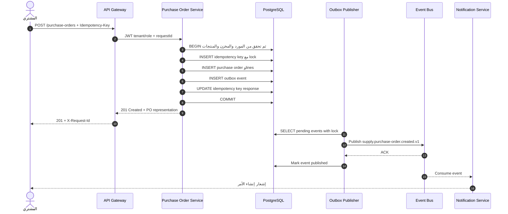
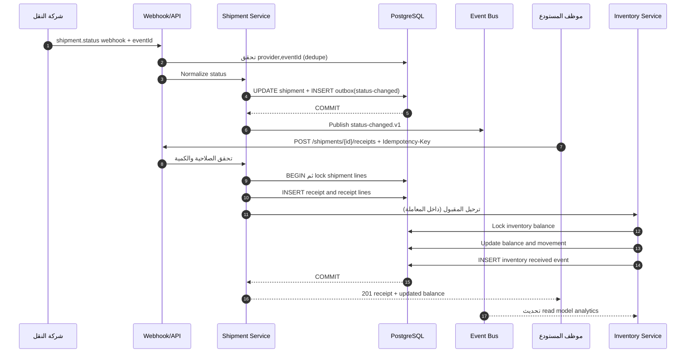
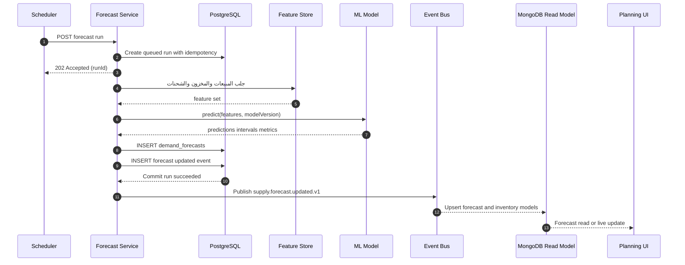

# وثيقة البيانات وواجهات API
## Smart Supply Chain Management System

**الإصدار:** 1.0.0
**الحالة:** تصميم مرجعي قابل للتنفيذ
**النطاق:** الموردون، المنتجات، المخزون، التنبؤ، أوامر الشراء، الشحنات، الاستلام، الأحداث والتكاملات.

## 1. مبادئ التصميم والافتراضات

- قاعدة البيانات العلائقية الأساسية هي **PostgreSQL 16**، مع `UUID` كمفاتيح عامة، و`NUMERIC` للقيم المالية والكميات، و`TIMESTAMPTZ` لكل التواريخ.
- البيانات التشغيلية التي تتطلب اتساقاً ومعاملات (المنتجات، المخزون، أوامر الشراء، الشحنات والاستلام) في PostgreSQL.
- **MongoDB** مخصص لقراءات التتبع السريعة، الخط الزمني للشحنات، لقطات التنبؤ، وسجل التكاملات؛ المصدر المرجعي للبيانات المالية وحالات الكيانات هو PostgreSQL.
- نشر الأحداث يتم عبر **Transactional Outbox** إلى Kafka/موضوعات events. لا ينشر التطبيق الحدث مباشرة بعد `COMMIT` دون outbox.
- كل endpoint الكتابة يقبل `Idempotency-Key`؛ القيمة فريدة ضمن `(tenant_id, key, route)`، وتُحفظ نتيجة الطلب لإعادة نفس الاستجابة عند التكرار.
- كل الموارد متعددة المستأجرين؛ لا يجوز الوصول إلى سجل خارج `tenant_id` الموجود في JWT.
- المنطقة الزمنية المخزنة UTC، وواجهة API تعرض ISO-8601 مثل `2026-11-19T14:45:00Z`.
- حالات الكيانات محكومة بانتقالات صريحة؛ لا يُسمح بتعديل حالة أمر الشراء أو الشحنة مباشرة من واجهة عامة.

## 2. نموذج PostgreSQL العلائقي

### 2.1 أنواع مشتركة وامتدادات

```sql
CREATE EXTENSION IF NOT EXISTS pgcrypto;
CREATE EXTENSION IF NOT EXISTS citext;

CREATE TYPE tenant_status AS ENUM ('active', 'suspended', 'deleted');
CREATE TYPE user_status AS ENUM ('active', 'invited', 'disabled');
CREATE TYPE supplier_status AS ENUM ('active', 'pending', 'suspended', 'archived');
CREATE TYPE product_status AS ENUM ('active', 'inactive', 'discontinued');
CREATE TYPE warehouse_status AS ENUM ('active', 'inactive');
CREATE TYPE purchase_order_status AS ENUM
  ('draft', 'submitted', 'approved', 'partially_received', 'received', 'cancelled', 'closed');
CREATE TYPE po_line_status AS ENUM ('open', 'partially_received', 'received', 'cancelled');
CREATE TYPE shipment_status AS ENUM
  ('planned', 'booked', 'in_transit', 'at_customs', 'delivered', 'partially_received', 'cancelled');
CREATE TYPE inventory_movement_type AS ENUM
  ('receipt', 'issue', 'reservation', 'release', 'adjustment', 'transfer_in', 'transfer_out', 'return');
CREATE TYPE forecast_method AS ENUM ('statistical', 'ml', 'manual', 'ensemble');
CREATE TYPE outbox_status AS ENUM ('pending', 'published', 'failed');
```

### 2.2 الجداول الأساسية

```sql
CREATE TABLE tenants (
  id UUID PRIMARY KEY DEFAULT gen_random_uuid(),
  code CITEXT NOT NULL UNIQUE,
  name TEXT NOT NULL,
  status tenant_status NOT NULL DEFAULT 'active',
  default_currency CHAR(3) NOT NULL DEFAULT 'USD',
  timezone TEXT NOT NULL DEFAULT 'UTC',
  created_at TIMESTAMPTZ NOT NULL DEFAULT now(),
  updated_at TIMESTAMPTZ NOT NULL DEFAULT now()
);

CREATE TABLE users (
  id UUID PRIMARY KEY DEFAULT gen_random_uuid(),
  tenant_id UUID NOT NULL REFERENCES tenants(id),
  email CITEXT NOT NULL,
  display_name TEXT NOT NULL,
  status user_status NOT NULL DEFAULT 'invited',
  roles JSONB NOT NULL DEFAULT '[]',
  created_at TIMESTAMPTZ NOT NULL DEFAULT now(),
  updated_at TIMESTAMPTZ NOT NULL DEFAULT now(),
  UNIQUE (tenant_id, email)
);

CREATE TABLE suppliers (
  id UUID PRIMARY KEY DEFAULT gen_random_uuid(),
  tenant_id UUID NOT NULL REFERENCES tenants(id),
  supplier_code TEXT NOT NULL,
  legal_name TEXT NOT NULL,
  tax_id TEXT,
  status supplier_status NOT NULL DEFAULT 'pending',
  lead_time_days INTEGER NOT NULL DEFAULT 0 CHECK (lead_time_days >= 0),
  payment_terms_days INTEGER NOT NULL DEFAULT 30 CHECK (payment_terms_days >= 0),
  currency CHAR(3) NOT NULL DEFAULT 'USD',
  contacts JSONB NOT NULL DEFAULT '[]',
  address JSONB NOT NULL DEFAULT '{}',
  created_at TIMESTAMPTZ NOT NULL DEFAULT now(),
  updated_at TIMESTAMPTZ NOT NULL DEFAULT now(),
  UNIQUE (tenant_id, supplier_code)
);

CREATE TABLE warehouses (
  id UUID PRIMARY KEY DEFAULT gen_random_uuid(),
  tenant_id UUID NOT NULL REFERENCES tenants(id),
  warehouse_code TEXT NOT NULL,
  name TEXT NOT NULL,
  status warehouse_status NOT NULL DEFAULT 'active',
  address JSONB NOT NULL DEFAULT '{}',
  timezone TEXT NOT NULL DEFAULT 'UTC',
  created_at TIMESTAMPTZ NOT NULL DEFAULT now(),
  UNIQUE (tenant_id, warehouse_code)
);

CREATE TABLE products (
  id UUID PRIMARY KEY DEFAULT gen_random_uuid(),
  tenant_id UUID NOT NULL REFERENCES tenants(id),
  sku TEXT NOT NULL,
  name TEXT NOT NULL,
  description TEXT,
  category TEXT,
  unit_of_measure TEXT NOT NULL,
  status product_status NOT NULL DEFAULT 'active',
  reorder_point NUMERIC(18,4) NOT NULL DEFAULT 0 CHECK (reorder_point >= 0),
  safety_stock NUMERIC(18,4) NOT NULL DEFAULT 0 CHECK (safety_stock >= 0),
  standard_cost NUMERIC(18,4) NOT NULL DEFAULT 0 CHECK (standard_cost >= 0),
  attributes JSONB NOT NULL DEFAULT '{}',
  created_at TIMESTAMPTZ NOT NULL DEFAULT now(),
  updated_at TIMESTAMPTZ NOT NULL DEFAULT now(),
  UNIQUE (tenant_id, sku)
);

CREATE TABLE supplier_products (
  supplier_id UUID NOT NULL REFERENCES suppliers(id),
  product_id UUID NOT NULL REFERENCES products(id),
  supplier_sku TEXT,
  unit_price NUMERIC(18,4) NOT NULL CHECK (unit_price >= 0),
  min_order_qty NUMERIC(18,4) NOT NULL DEFAULT 1 CHECK (min_order_qty > 0),
  pack_size NUMERIC(18,4) NOT NULL DEFAULT 1 CHECK (pack_size > 0),
  lead_time_days INTEGER NOT NULL CHECK (lead_time_days >= 0),
  is_preferred BOOLEAN NOT NULL DEFAULT false,
  valid_from DATE NOT NULL DEFAULT CURRENT_DATE,
  valid_to DATE,
  PRIMARY KEY (supplier_id, product_id),
  CHECK (valid_to IS NULL OR valid_to >= valid_from)
);

CREATE TABLE inventory_balances (
  tenant_id UUID NOT NULL REFERENCES tenants(id),
  warehouse_id UUID NOT NULL REFERENCES warehouses(id),
  product_id UUID NOT NULL REFERENCES products(id),
  on_hand NUMERIC(18,4) NOT NULL DEFAULT 0 CHECK (on_hand >= 0),
  reserved NUMERIC(18,4) NOT NULL DEFAULT 0 CHECK (reserved >= 0),
  on_order NUMERIC(18,4) NOT NULL DEFAULT 0 CHECK (on_order >= 0),
  available NUMERIC(18,4) GENERATED ALWAYS AS (on_hand - reserved) STORED,
  version BIGINT NOT NULL DEFAULT 0,
  updated_at TIMESTAMPTZ NOT NULL DEFAULT now(),
  PRIMARY KEY (warehouse_id, product_id)
);

CREATE TABLE inventory_movements (
  id UUID PRIMARY KEY DEFAULT gen_random_uuid(),
  tenant_id UUID NOT NULL REFERENCES tenants(id),
  warehouse_id UUID NOT NULL REFERENCES warehouses(id),
  product_id UUID NOT NULL REFERENCES products(id),
  movement_type inventory_movement_type NOT NULL,
  quantity NUMERIC(18,4) NOT NULL CHECK (quantity > 0),
  reference_type TEXT,
  reference_id UUID,
  lot_number TEXT,
  occurred_at TIMESTAMPTZ NOT NULL DEFAULT now(),
  created_by UUID REFERENCES users(id),
  metadata JSONB NOT NULL DEFAULT '{}'
);

CREATE TABLE purchase_orders (
  id UUID PRIMARY KEY DEFAULT gen_random_uuid(),
  tenant_id UUID NOT NULL REFERENCES tenants(id),
  po_number TEXT NOT NULL,
  supplier_id UUID NOT NULL REFERENCES suppliers(id),
  warehouse_id UUID NOT NULL REFERENCES warehouses(id),
  status purchase_order_status NOT NULL DEFAULT 'draft',
  currency CHAR(3) NOT NULL,
  subtotal NUMERIC(18,4) NOT NULL DEFAULT 0 CHECK (subtotal >= 0),
  tax_total NUMERIC(18,4) NOT NULL DEFAULT 0 CHECK (tax_total >= 0),
  total NUMERIC(18,4) NOT NULL DEFAULT 0 CHECK (total >= 0),
  expected_delivery_date DATE,
  notes TEXT,
  created_by UUID NOT NULL REFERENCES users(id),
  approved_by UUID REFERENCES users(id),
  submitted_at TIMESTAMPTZ,
  approved_at TIMESTAMPTZ,
  created_at TIMESTAMPTZ NOT NULL DEFAULT now(),
  updated_at TIMESTAMPTZ NOT NULL DEFAULT now(),
  UNIQUE (tenant_id, po_number)
);

CREATE TABLE purchase_order_lines (
  id UUID PRIMARY KEY DEFAULT gen_random_uuid(),
  purchase_order_id UUID NOT NULL REFERENCES purchase_orders(id) ON DELETE CASCADE,
  product_id UUID NOT NULL REFERENCES products(id),
  line_no INTEGER NOT NULL,
  ordered_qty NUMERIC(18,4) NOT NULL CHECK (ordered_qty > 0),
  received_qty NUMERIC(18,4) NOT NULL DEFAULT 0 CHECK (received_qty >= 0),
  unit_price NUMERIC(18,4) NOT NULL CHECK (unit_price >= 0),
  tax_rate NUMERIC(8,5) NOT NULL DEFAULT 0 CHECK (tax_rate >= 0),
  status po_line_status NOT NULL DEFAULT 'open',
  UNIQUE (purchase_order_id, line_no),
  CHECK (received_qty <= ordered_qty)
);

CREATE TABLE shipments (
  id UUID PRIMARY KEY DEFAULT gen_random_uuid(),
  tenant_id UUID NOT NULL REFERENCES tenants(id),
  shipment_number TEXT NOT NULL,
  purchase_order_id UUID NOT NULL REFERENCES purchase_orders(id),
  carrier_name TEXT,
  tracking_number TEXT,
  status shipment_status NOT NULL DEFAULT 'planned',
  origin JSONB NOT NULL DEFAULT '{}',
  destination JSONB NOT NULL DEFAULT '{}',
  planned_departure_at TIMESTAMPTZ,
  actual_departure_at TIMESTAMPTZ,
  estimated_arrival_at TIMESTAMPTZ,
  actual_arrival_at TIMESTAMPTZ,
  customs JSONB NOT NULL DEFAULT '{}',
  created_at TIMESTAMPTZ NOT NULL DEFAULT now(),
  updated_at TIMESTAMPTZ NOT NULL DEFAULT now(),
  UNIQUE (tenant_id, shipment_number),
  UNIQUE (tenant_id, carrier_name, tracking_number)
);

CREATE TABLE shipment_lines (
  id UUID PRIMARY KEY DEFAULT gen_random_uuid(),
  shipment_id UUID NOT NULL REFERENCES shipments(id) ON DELETE CASCADE,
  purchase_order_line_id UUID NOT NULL REFERENCES purchase_order_lines(id),
  shipped_qty NUMERIC(18,4) NOT NULL CHECK (shipped_qty > 0),
  received_qty NUMERIC(18,4) NOT NULL DEFAULT 0 CHECK (received_qty >= 0),
  lot_number TEXT,
  UNIQUE (shipment_id, purchase_order_line_id),
  CHECK (received_qty <= shipped_qty)
);

CREATE TABLE receipts (
  id UUID PRIMARY KEY DEFAULT gen_random_uuid(),
  tenant_id UUID NOT NULL REFERENCES tenants(id),
  receipt_number TEXT NOT NULL,
  shipment_id UUID NOT NULL REFERENCES shipments(id),
  warehouse_id UUID NOT NULL REFERENCES warehouses(id),
  status TEXT NOT NULL DEFAULT 'posted' CHECK (status IN ('draft','posted','reversed')),
  received_at TIMESTAMPTZ NOT NULL DEFAULT now(),
  received_by UUID NOT NULL REFERENCES users(id),
  notes TEXT,
  UNIQUE (tenant_id, receipt_number)
);

CREATE TABLE receipt_lines (
  id UUID PRIMARY KEY DEFAULT gen_random_uuid(),
  receipt_id UUID NOT NULL REFERENCES receipts(id) ON DELETE CASCADE,
  shipment_line_id UUID NOT NULL REFERENCES shipment_lines(id),
  accepted_qty NUMERIC(18,4) NOT NULL DEFAULT 0 CHECK (accepted_qty >= 0),
  rejected_qty NUMERIC(18,4) NOT NULL DEFAULT 0 CHECK (rejected_qty >= 0),
  rejection_reason TEXT,
  lot_number TEXT,
  UNIQUE (receipt_id, shipment_line_id)
);

CREATE TABLE demand_forecasts (
  id UUID PRIMARY KEY DEFAULT gen_random_uuid(),
  tenant_id UUID NOT NULL REFERENCES tenants(id),
  product_id UUID NOT NULL REFERENCES products(id),
  warehouse_id UUID NOT NULL REFERENCES warehouses(id),
  forecast_date DATE NOT NULL,
  horizon_days INTEGER NOT NULL CHECK (horizon_days > 0),
  predicted_qty NUMERIC(18,4) NOT NULL CHECK (predicted_qty >= 0),
  lower_bound NUMERIC(18,4),
  upper_bound NUMERIC(18,4),
  method forecast_method NOT NULL,
  model_version TEXT NOT NULL,
  confidence NUMERIC(6,5) CHECK (confidence BETWEEN 0 AND 1),
  generated_at TIMESTAMPTZ NOT NULL DEFAULT now(),
  UNIQUE (warehouse_id, product_id, forecast_date, model_version)
);

CREATE TABLE outbox_events (
  id UUID PRIMARY KEY DEFAULT gen_random_uuid(),
  tenant_id UUID NOT NULL REFERENCES tenants(id),
  aggregate_type TEXT NOT NULL,
  aggregate_id UUID NOT NULL,
  event_type TEXT NOT NULL,
  event_version INTEGER NOT NULL DEFAULT 1,
  idempotency_key TEXT NOT NULL,
  payload JSONB NOT NULL,
  status outbox_status NOT NULL DEFAULT 'pending',
  occurred_at TIMESTAMPTZ NOT NULL DEFAULT now(),
  published_at TIMESTAMPTZ,
  attempts INTEGER NOT NULL DEFAULT 0,
  last_error TEXT,
  UNIQUE (tenant_id, idempotency_key)
);

CREATE TABLE idempotency_keys (
  tenant_id UUID NOT NULL REFERENCES tenants(id),
  route TEXT NOT NULL,
  key TEXT NOT NULL,
  request_hash TEXT NOT NULL,
  status_code INTEGER,
  response_body JSONB,
  response_headers JSONB,
  locked_at TIMESTAMPTZ NOT NULL DEFAULT now(),
  completed_at TIMESTAMPTZ,
  PRIMARY KEY (tenant_id, route, key)
);
```

### 2.3 الفهارس والقيود التشغيلية

```sql
CREATE INDEX idx_products_tenant_status ON products(tenant_id, status);
CREATE INDEX idx_inventory_product ON inventory_balances(tenant_id, product_id);
CREATE INDEX idx_movements_product_time ON inventory_movements(product_id, occurred_at DESC);
CREATE INDEX idx_po_supplier_status ON purchase_orders(tenant_id, supplier_id, status);
CREATE INDEX idx_po_updated ON purchase_orders(tenant_id, updated_at DESC);
CREATE INDEX idx_shipments_status_eta ON shipments(tenant_id, status, estimated_arrival_at);
CREATE INDEX idx_forecasts_lookup ON demand_forecasts(tenant_id, warehouse_id, product_id, forecast_date DESC);
CREATE INDEX idx_outbox_pending ON outbox_events(status, occurred_at) WHERE status = 'pending';

-- تطبيق RLS في كل جدول يحتوي tenant_id، مع ضبط app.tenant_id من طبقة الاتصال.
ALTER TABLE suppliers ENABLE ROW LEVEL SECURITY;
ALTER TABLE products ENABLE ROW LEVEL SECURITY;
ALTER TABLE purchase_orders ENABLE ROW LEVEL SECURITY;
ALTER TABLE shipments ENABLE ROW LEVEL SECURITY;
CREATE POLICY tenant_isolation_suppliers ON suppliers
  USING (tenant_id = current_setting('app.tenant_id')::uuid);
```

**معاملات حرجة:** إنشاء أمر الشراء يتم داخل معاملة واحدة تشمل الرؤوس والبنود وحدث outbox. ترحيل الاستلام يقفل صف `inventory_balances` بـ `SELECT ... FOR UPDATE`، يتحقق من عدم تجاوز الكمية، يضيف الحركة، يحدث الرصيد، ثم يضيف الحدث قبل الإقرار.

### 2.4 العلاقات الرئيسية

- `tenants 1:N users, suppliers, warehouses, products, purchase_orders, shipments, forecasts`.
- `suppliers N:M products` عبر `supplier_products`.
- `warehouses N:M products` عبر `inventory_balances`، مع سجل حركات في `inventory_movements`.
- `purchase_orders 1:N purchase_order_lines`، وكل بند يشير إلى منتج.
- `purchase_orders 1:N shipments`، و`shipments 1:N shipment_lines`، وكل سطر شحنة يرتبط ببند شراء.
- `shipments 1:N receipts`، و`receipts 1:N receipt_lines`، وسطر الاستلام يحدّث المخزون.
- `outbox_events` و`idempotency_keys` يربطان الأثر التشغيلي بالتكامل دون تغيير نموذج الأعمال.

## 3. Collections في MongoDB

قاعدة البيانات المقترحة `smart_supply_chain_read`; جميع الوثائق تحتوي `tenantId` و`schemaVersion` وحقول التدقيق.

### 3.1 `shipment_tracking`

```json
{
  "_id": "shipment-uuid",
  "tenantId": "tenant-uuid",
  "shipmentNumber": "SHP-2026-00042",
  "status": "in_transit",
  "carrier": {"name": "ACME Logistics", "trackingNumber": "TRK-9"},
  "route": {"origin": {}, "destination": {}},
  "latestPosition": {"lat": 24.7136, "lon": 46.6753, "at": "2026-11-19T14:00:00Z"},
  "milestones": [
    {"code": "departed", "at": "2026-11-18T08:00:00Z", "source": "carrier-webhook"}
  ],
  "exceptions": [],
  "updatedAt": "2026-11-19T14:00:00Z",
  "schemaVersion": 1
}
```
الفهارس: `{tenantId:1, shipmentNumber:1}` unique، و`{tenantId:1, status:1, updatedAt:-1}`، و`{latestPosition: "2dsphere"}` عند الحاجة.

### 3.2 `forecast_snapshots`

```json
{
  "_id": "forecast-run-uuid",
  "tenantId": "tenant-uuid",
  "runId": "run-uuid",
  "model": {"name": "demand-ensemble", "version": "2026.11.3"},
  "generatedAt": "2026-11-19T02:00:00Z",
  "items": [
    {"productId": "product-uuid", "warehouseId": "warehouse-uuid", "date": "2026-12-01", "predictedQty": 120, "lower": 90, "upper": 155, "confidence": 0.86}
  ],
  "metrics": {"mae": 8.4, "wmape": 0.12},
  "schemaVersion": 1
}
```
الفهارس: `{tenantId:1, generatedAt:-1}` و`{tenantId:1, "items.productId":1, generatedAt:-1}`.

### 3.3 `inventory_read_models`

وثيقة denormalized للوحة التحكم: الرصيد المتاح، الطلب المتوقع، التغطية بالأيام، آخر حركة، ومؤشرات إعادة الطلب. تُبنى من أحداث المخزون والتنبؤ ولا تُستخدم كمرجع للترحيل.

### 3.4 `integration_deliveries`

تسجل webhook الوارد/الخارج: `deliveryId`, `tenantId`, `provider`, `eventId`, `payloadHash`, `receivedAt`, `processedAt`, `status`, `attempts`, `lastError`. فهرس unique على `(provider,eventId)` يمنع إعادة معالجة callback.

## 4. عقد الأحداث Event Schemas

### 4.1 الغلاف المشترك

كل حدث CloudEvents متوافق:

```json
{
  "specversion": "1.0",
  "id": "event-uuid",
  "type": "supply.purchase-order.created.v1",
  "source": "smart-supply-chain/orders-service",
  "subject": "purchase-order/po-uuid",
  "time": "2026-11-19T14:45:00Z",
  "datacontenttype": "application/json",
  "traceparent": "00-...",
  "data": {},
  "tenantId": "tenant-uuid",
  "correlationId": "request-uuid",
  "causationId": "event-uuid-or-request-uuid"
}
```

التسلسل في اسم الحدث `domain.entity.action.vN`، والمستهلك يجب أن يكون idempotent باستخدام `event.id` أو `(tenantId, event.id)`.

### 4.2 `supply.purchase-order.created.v1`

```json
{
  "poId": "po-uuid",
  "poNumber": "PO-2026-00101",
  "supplierId": "supplier-uuid",
  "warehouseId": "warehouse-uuid",
  "status": "draft",
  "currency": "USD",
  "total": "12500.00",
  "lines": [{"lineId": "line-uuid", "productId": "product-uuid", "orderedQty": "100", "unitPrice": "125.00"}]
}
```

### 4.3 `supply.shipment.status-changed.v1`

```json
{
  "shipmentId": "shipment-uuid",
  "shipmentNumber": "SHP-2026-00042",
  "purchaseOrderId": "po-uuid",
  "previousStatus": "booked",
  "status": "in_transit",
  "trackingNumber": "TRK-9",
  "occurredAt": "2026-11-19T14:00:00Z",
  "location": {"lat": 24.7136, "lon": 46.6753}
}
```

### 4.4 `supply.inventory.received.v1`

```json
{
  "receiptId": "receipt-uuid",
  "receiptNumber": "GRN-2026-0042",
  "warehouseId": "warehouse-uuid",
  "shipmentId": "shipment-uuid",
  "lines": [{"productId": "product-uuid", "acceptedQty": "80", "rejectedQty": "2", "lotNumber": "LOT-9"}],
  "receivedAt": "2026-11-19T15:00:00Z"
}
```

### 4.5 `supply.forecast.updated.v1`

```json
{
  "runId": "run-uuid",
  "modelVersion": "2026.11.3",
  "generatedAt": "2026-11-19T02:00:00Z",
  "items": [{"productId": "product-uuid", "warehouseId": "warehouse-uuid", "forecastDate": "2026-12-01", "predictedQty": "120", "confidence": 0.86}],
  "metrics": {"wmape": 0.12}
}
```

### 4.6 ضمانات النشر والاستهلاك

- Kafka key = `tenantId:aggregateId` للحفاظ على ترتيب أحداث الكيان.
- سياسة إعادة المحاولة: exponential backoff حتى 5 محاولات ثم Dead Letter Topic.
- لا يُعتبر الحدث منشوراً إلا بعد تأكيد broker وتحديث `outbox_events.status`.
- يتطلب كل مستهلك جدول/collection لمعالجة `eventId` مرة واحدة، مع مراقبة lag وDLQ.

## 5. API Documentation

### 5.1 قواعد عامة

Base URL: `/api/v1`
المصادقة: `Authorization: Bearer <JWT>`، ويحتوي JWT على `sub`, `tenant_id`, `roles`.
الرؤوس: `X-Request-Id` اختياري (يُولد تلقائياً)، و`Idempotency-Key` مطلوب للـ POST/PATCH التي تغيّر الحالة.
الترقيم: `page` يبدأ من 1، `pageSize` من 1 إلى 100، والفرز allow-list فقط.

استجابة الخطأ الموحدة:

```json
{
  "error": {
    "code": "VALIDATION_ERROR",
    "message": "الطلب غير صالح",
    "details": [{"field": "lines[0].orderedQty", "reason": "must be greater than zero"}],
    "requestId": "request-uuid"
  }
}
```

### 5.2 إنشاء أمر شراء

`POST /api/v1/purchase-orders`
**الصلاحية:** `purchasing:write`
**Idempotency:** مطلوب؛ إعادة استخدام المفتاح مع body مختلف تعيد `409 IDEMPOTENCY_KEY_REUSED`.

Request:

```json
{
  "supplierId": "supplier-uuid",
  "warehouseId": "warehouse-uuid",
  "currency": "USD",
  "expectedDeliveryDate": "2026-12-05",
  "lines": [
    {"productId": "product-uuid", "orderedQty": "100", "unitPrice": "125.00", "taxRate": "0.15"}
  ],
  "notes": "طلب إعادة تخزين"
}
```

Response `201 Created`:

```json
{
  "data": {
    "id": "po-uuid", "poNumber": "PO-2026-00101", "status": "draft",
    "supplierId": "supplier-uuid", "warehouseId": "warehouse-uuid",
    "subtotal": "12500.00", "taxTotal": "1875.00", "total": "14375.00",
    "lines": [{"id": "line-uuid", "lineNo": 1, "productId": "product-uuid", "orderedQty": "100", "receivedQty": "0", "status": "open"}],
    "createdAt": "2026-11-19T14:45:00Z"
  }
}
```

### 5.3 إرسال/اعتماد أمر شراء

`POST /api/v1/purchase-orders/{poId}/submit` و`POST /api/v1/purchase-orders/{poId}/approve`
**الصلاحية:** `purchasing:write` ثم `purchasing:approve`.
Body اختياري: `{"comment":"..."}`.
Response `200`: المورد، الحالة الجديدة، `version`, و`submittedAt`/`approvedAt`. العملية idempotent: إذا كانت الحالة بالفعل الهدف، تعاد `200` بنفس التمثيل؛ إذا كان الانتقال غير مسموح `409 INVALID_STATE_TRANSITION`.

### 5.4 قراءة أوامر الشراء

`GET /api/v1/purchase-orders?status=approved&supplierId=<uuid>&page=1&pageSize=25&sort=-createdAt`
Response `200`:

```json
{"data":[{"id":"po-uuid","poNumber":"PO-2026-00101","status":"approved","total":"14375.00","supplier":{"id":"supplier-uuid","name":"ACME"}}],"meta":{"page":1,"pageSize":25,"total":1}}
```

`GET /api/v1/purchase-orders/{poId}` يعيد الرأس والبنود والشحنات المرتبطة و`ETag`. يدعم `If-None-Match` وإرجاع `304`.

### 5.5 إنشاء شحنة وربطها بأمر شراء

`POST /api/v1/purchase-orders/{poId}/shipments`
**الصلاحية:** `logistics:write`، **Idempotency:** مطلوب.

Request:

```json
{
  "carrierName": "ACME Logistics",
  "trackingNumber": "TRK-9",
  "plannedDepartureAt": "2026-11-20T08:00:00Z",
  "estimatedArrivalAt": "2026-11-25T16:00:00Z",
  "lines": [{"purchaseOrderLineId":"line-uuid","shippedQty":"100","lotNumber":"LOT-9"}]
}
```

Response `201`: `shipmentId`, `shipmentNumber`, `status: planned`, البنود، وأول event ID. يتحقق الخادم من أن الكمية المشحونة لا تتجاوز الكمية المتبقية في بند الشراء.

### 5.6 تحديث حالة شحنة

`POST /api/v1/shipments/{shipmentId}/status`
Request: `{"status":"in_transit","occurredAt":"2026-11-19T14:00:00Z","location":{"lat":24.7136,"lon":46.6753}}`
Response `200`: الشحنة بالحالة الجديدة و`eventId`. التكرار بنفس `Idempotency-Key` يعيد نفس النتيجة. حالة غير مسموحة تعيد `409 INVALID_STATE_TRANSITION`.

### 5.7 تسجيل الاستلام وترحيل المخزون

`POST /api/v1/shipments/{shipmentId}/receipts`
**الصلاحية:** `warehouse:write`، **Idempotency:** مطلوب.

Request:

```json
{
  "warehouseId": "warehouse-uuid",
  "receivedAt": "2026-11-19T15:00:00Z",
  "lines": [{"shipmentLineId":"shipment-line-uuid","acceptedQty":"80","rejectedQty":"2","rejectionReason":"damage","lotNumber":"LOT-9"}],
  "notes": "استلام جزئي"
}
```

Response `201` يعيد `receiptId`, `receiptNumber`, مجموع المقبول/المرفوض، حالة الشحنة (`partially_received`) ولقطة الرصيد بعد الترحيل. إذا تجاوزت الكمية المتبقية `409 RECEIPT_QTY_EXCEEDS_OPEN_QTY`.

### 5.8 قراءة المخزون

`GET /api/v1/inventory?warehouseId=<uuid>&productId=<uuid>&lowStock=true`
Response `200`:

```json
{"data":[{"warehouseId":"warehouse-uuid","productId":"product-uuid","onHand":"80","reserved":"10","available":"70","onOrder":"100","reorderPoint":"60","updatedAt":"2026-11-19T15:00:00Z"}],"meta":{"page":1,"pageSize":25,"total":1}}
```

### 5.9 تشغيل/قراءة التنبؤ

`POST /api/v1/forecasts/runs`
Request: `{"warehouseIds":["warehouse-uuid"],"productIds":["product-uuid"],"horizonDays":30,"method":"ensemble"}`
Response `202 Accepted`: `{"data":{"runId":"run-uuid","status":"queued"}}`. هذا endpoint idempotent بمفتاح الطلب؛ إذا كان التشغيل قيد التنفيذ يعيد `202` نفسه.

`GET /api/v1/forecasts?warehouseId=<uuid>&productId=<uuid>&from=2026-12-01&to=2026-12-30` يعيد نقاط التنبؤ وحدود الثقة وإصدار النموذج.

### 5.10 أكواد HTTP والأخطاء

| HTTP | code | المعنى |
|---:|---|---|
| 400 | `VALIDATION_ERROR` | JSON أو حقل غير صالح |
| 401 | `UNAUTHENTICATED` | JWT مفقود/منتهي |
| 403 | `FORBIDDEN` | لا توجد الصلاحية |
| 404 | `RESOURCE_NOT_FOUND` | المورد غير موجود ضمن المستأجر |
| 409 | `IDEMPOTENCY_KEY_REUSED` | نفس المفتاح مع body مختلف |
| 409 | `INVALID_STATE_TRANSITION` | انتقال حالة غير مسموح |
| 409 | `RECEIPT_QTY_EXCEEDS_OPEN_QTY` | تجاوز الكمية المتاحة |
| 409 | `OPTIMISTIC_LOCK_CONFLICT` | نسخة المورد تغيرت |
| 412 | `PRECONDITION_FAILED` | فشل `If-Match` |
| 422 | `BUSINESS_RULE_VIOLATION` | قاعدة أعمال مرفوضة |
| 429 | `RATE_LIMITED` | تجاوز المعدل؛ اقرأ `Retry-After` |
| 500 | `INTERNAL_ERROR` | خطأ غير متوقع؛ استخدم requestId |
| 503 | `DEPENDENCY_UNAVAILABLE` | قاعدة/ناقل أحداث/مزود خارجي غير متاح |

## 6. مخططات Sequence بصيغة Mermaid

### 6.1 إنشاء أمر شراء



### 6.2 معالجة شحنة واستلامها



### 6.3 تحديث تنبؤ الطلب



## 7. الأمن والمراقبة والتشغيل

- تطبيق RLS، والتحقق من `tenant_id` في الاستعلامات، ومنع تسريب IDs عبر رسائل 404.
- تشفير TLS أثناء النقل وتشفير الأسرار خارج المستودع؛ لا تسجل JWT أو payloads الحساسة في logs.
- سجلات التدقيق لكل تغيير حالة: actor، قبل/بعد، requestId، correlationId، timestamp.
- مقاييس أساسية: زمن API p50/p95، معدلات 4xx/5xx، outbox lag، Kafka consumer lag، DLQ count، دقة التنبؤ، وفشل webhooks.
- النسخ الاحتياطي لـ PostgreSQL واختبار الاستعادة دورياً؛ MongoDB read models قابلة لإعادة البناء من PostgreSQL/events.
- اختبارات عقد API/events، واختبارات انتقال الحالات، واختبارات concurrent receipt تثبت عدم تجاوز المخزون/الكمية.

## 8. قرارات قابلة للتغيير لاحقاً

يمكن استبدال MongoDB بـ Elasticsearch/OpenSearch للبحث، أو Kafka بناقل آخر، دون تغيير API إذا بقيت outbox والعقود event versioned. أي تغيير كاسر يتطلب إصدار `v2` وعدم تعديل معنى حقول `v1`، مع فترة توافق للمستهلكين.
